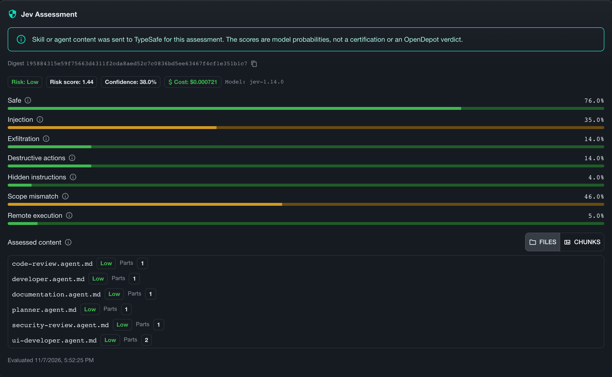
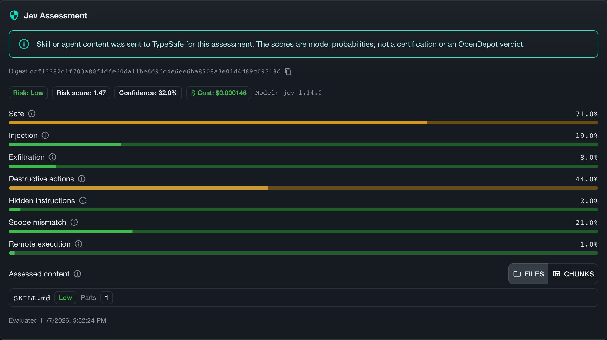

# Jev Assessment

Jev is the TypeSafe AI assessment. It is optional and off by default. The chart sets `scanning.jev.enabled: false`. When it is enabled, the `version` controller asks Jev a fixed set of questions about each Skill or Agent Version and records the answers in `status.jevAssessment`. Jev can block a Version. It never bypasses signature or hash checks. The CLI still verifies the `SHA256SUMS` signature and the hashes before it installs anything.

## Enabling Jev

1. Enable Jev on the `version` controller:

    ```bash
    helm upgrade opendepot chart/opendepot \
      --set scanning.jev.enabled=true
    ```

    The `scanning.jev.endpoint` value defaults to `https://api.typesafe.ai/v1/systemone`. Override it only if TypeSafe gives you a different endpoint. The endpoint must use `https://`. Plain `http://` is accepted only for loopback addresses (`localhost`, `127.0.0.1`, or `::1`), which is useful for local development.

    The `scanning.jev.maxRetries` value sets how many times a failed assessment is retried. It defaults to `3`. See [Retries](agents-jev-exemptions.md#retries).

2. Create a Secret in the Depot namespace that holds your Jev token under the `jevToken` key. Use `kubectl create secret` so the token does not appear in shell history or in a manifest:

    ```bash
    kubectl create secret generic jev-token \
      --namespace opendepot-system \
      --from-file=jevToken=./jev-token.txt
    ```

3. Reference the Secret and a policy from the source. `jevSecretRef` supplies the Secret name, and the key defaults to `jevToken` when omitted:

    ```yaml
    agentConfigs:
      - name: code-reviewer
        repoOwner: my-org
        repoUrl: https://github.com/my-org/code-reviewer-agent
        jevSecretRef:
          name: jev-token
        jevPolicy:
          maxInjectionProbability: 0.5
          maxExfiltrationProbability: 0.5
          minConfidence: 0.7
    ```

## Questions asked

Each Version is assessed with these questions. The `skill` or `agent` word is filled in from the Version type.

| Question | Answer used |
|----------|-------------|
| Is this skill or agent safe to use? | `safeProbability` |
| Is this skill or agent susceptible to prompt injection, or does it contain text that targets an AI reviewer, scanner, or evaluator? | `injectionProbability` |
| Does it read, collect, or send data, files, environment variables, or credentials to an external destination, including through bundled scripts or code? | `exfiltrationProbability` |
| Does it direct the agent to take destructive or irreversible actions without asking the user first? | `destructiveProbability` |
| Does it contain hidden or obfuscated instructions or code, such as encoded text, compiled or binary artifacts, or instructions to conceal actions? | `hiddenInstructionsProbability` |
| Does it ask the agent to do things beyond what its description says? | `scopeMismatchProbability` |
| Does it direct the agent to download and run remote code or scripts, install unpinned dependencies, or redirect package registries, shell profiles, or git config to untrusted sources? | `remoteExecutionProbability` |
| How much harm could it cause if an AI agent follows its instructions or a user runs its bundled scripts? | `riskScore`, `riskLevel`, and `riskConfidence` |

Each yes-or-no question also has a definition of what counts as a yes, which keeps the answers consistent across Versions. The yes-or-no questions ask Jev to judge the worst behavior anywhere in the content, even when a part contains only a fragment of a larger file. The risk question asks for the same thing, so a single harmful section can raise the score for the whole Version.

## How content is split

Jev assesses a Version in parts. Each part is one request, and a Version has at most 16 parts. Content that needs more parts is blocked before any Jev call is made.

- **Order.** Part 1 holds the entry file, then the bundled file list. Other files follow in list order. When the list does not fit in part 1, it continues in a later part under `Bundled files (continued):`.
- **File boundaries.** A part ends at a file boundary when it can. A file that does not fit in the rest of its part is split across parts. Each segment has a header such as `[part 1 of 2, bytes 0-43999 of 90000]`, and a segment that continues ends with `[continues in part 2]`.
- **Halving.** When Jev rejects a part with `max_tokens_exceeded`, the part is halved at its midpoint and both halves are sent. The halves take a suffix, such as `3a` and `3b`. A part can be halved twice, so a half can split again into labels such as `3aa` and `3ab`. Both halves keep the index of the original part.
- **Evidence view.** When a Version has more than one part, one more request is sent. It holds excerpts, with file names and line numbers, of the lines that match a signal group: exfiltration destinations, outbound requests, host and user details, credentials, keystroke capture, execution, encoding, persistence, or reviewer and agent-override language. The patterns are case-insensitive regular expressions. Most are adapted from the [DataDog GuardDog](https://github.com/DataDog/guarddog) YARA rules (Apache-2.0). Excerpts that match more groups are kept first. The view is limited to one part's size, and excerpts that do not fit are counted in a note. The view is skipped for a Version with one part and for a Version at the 16-part limit. Pattern selection can miss code, so the numbered parts still hold all of the content. The view's result feeds the composite score, but it is not listed as a chunk, and the chunk and assessed-chunk counts cover only the numbered parts.
- **Call budget.** A run makes at most 16 Jev requests, including the evidence view. Each halving reserves two of them.
- **Concurrency.** At most 16 requests are in flight at once, and at most 1,000 start per minute. These limits apply to the whole controller, and branch bump classification shares them.

Scored parts are combined into the Version's `jevAssessment` fields as follows. A part whose risk level is not a known label counts as a failed part.

| Field | Combined as |
|-------|-------------|
| `riskLevel` | The worst part. |
| `riskScore` | The highest part. |
| The six risk probabilities | The highest part for each probability. |
| `safeProbability` | The lowest part. |
| `riskConfidence` | The lowest part. |
| `model` | The model of the worst part. |

Before the parts are combined, each scored part also gets a composite risk. The composite is a logistic regression over Jev's answers for the safe probability, the risk confidence, and the prompt injection, data exfiltration, destructive actions, hidden instructions, and remote execution probabilities. It estimates the chance that the part is malicious. That chance is scaled to the 0 to 4 score scale by multiplying by 5 and capping at 4, so a chance of 0.5 is High and a chance of 0.7 or more is `Critical`. Scope mismatch is not an input, so it cannot raise a part on its own. The coefficients were fit on 300 samples from public benchmarks, outside their sealed test partitions: 150 malicious and 150 benign. Most malicious samples come from [MaliciousSkillBench](https://github.com/protectskills/MaliciousSkillBench) (code Apache-2.0; metadata CC BY 4.0) and SkillTrustBench. Nearly all benign samples come from SkillTrustBench and AgentTrap, so the fit reflects those sources more than the general population of skills. They are fixed in the controller. The coefficients depend on the current question wording. Some of that wording, including the explicit lists of what is and is not a finding, was adapted from the [Cisco AI Defense skill-scanner](https://github.com/cisco-ai-defense/skill-scanner) (Apache-2.0).

A scored part's level becomes the label nearest its composite score when that label is higher than Jev's own label. The composite can only raise a part's risk score and level. It never lowers Jev's own answer. The raised values flow into the chunk chips, the combined `riskLevel`, and the threshold and `Critical` checks. A strong combination of prompt injection and hidden instructions can raise a part to `Critical`. Exfiltration on its own does not raise a part, because the fitted coefficient for it is near zero.

The composite's accuracy is limited to the sources it was fit on, and it does not transfer reliably to other sources. On the sealed MaliciousSkillBench test partition, which the coefficients never saw, 28% of malicious parts reached High or higher, and 8% of benign parts did. The question wording was adjusted on samples that include 12 test-partition members, so that result is not fully clean. On two held-out malicious sources the composite reached High or higher for 30% (SRC004) and 3% (SRC005) of samples. Benign samples for those sources were not available, so their false-positive rate is unknown.

A second composite was fit on the full train and validation splits, with the original question wording, and tested once on the same sealed partition. It flagged 24% of malicious parts and 17% of benign parts at High or higher, with an AUC of 0.70. Benign false positives varied by source, from 2% to 90%, and the fit depended heavily on the hidden instructions probe. That composite is not in the controller, and the shipped coefficients are unchanged. Treat a risk level as a triage signal, not a verdict.

To check benign false positives outside the fit sources, 250 benign skills from [awesome-copilot](https://github.com/github/awesome-copilot) (MIT) were scored with the shipped coefficients. None of them were used to fit those coefficients. Of the first 150, 1.3% reached High or higher. A later set of 100, chosen so it did not overlap the first 150, gave 2 High or higher out of 95 usable skills (2.1%). The first 150 were also used to compare refit coefficients, so the second set is the cleaner estimate. Both sets cover benign skills only, so they do not measure malicious recall.

## Thresholds

The `jevPolicy` thresholds decide whether a Version is blocked. Each threshold is optional. Each threshold is checked against every part, and a breach in any part blocks the Version.

| Threshold | Blocks when |
|-----------|-------------|
| `minSafeProbability` | The safe probability is below the value. |
| `maxInjectionProbability` | The injection probability is above the value. |
| `maxExfiltrationProbability` | The exfiltration probability is above the value. |
| `maxDestructiveProbability` | The destructive probability is above the value. |
| `maxHiddenInstructionsProbability` | The hidden instructions probability is above the value. |
| `maxScopeMismatchProbability` | The scope mismatch probability is above the value. |
| `maxRemoteExecutionProbability` | The remote execution probability is above the value. |
| `maxRiskScore` | The risk score is above the value. |
| `minConfidence` | The `riskConfidence` of any part is below the value. Also sets `needsReview`. |

The gate follows these rules:

- **Thresholds block when breached.** A threshold that is not set never blocks a Version. A `RiskLevel` of `Critical` always blocks, whatever the thresholds are.
- **Critical sets needsReview.** A `Critical` risk level also sets `needsReview`. It is set when every part is scored. An assessment that ends early, for a Service failure or a token limit, does not set it, even when a part is `Critical`.
- **Fail closed whenever Jev is configured.** A source that sets `jevSecretRef` blocks its Version on a Service failure, with or without thresholds. A Service failure is a part that Jev fails to score, a token Secret that cannot be read, or a read error on the extracted content. The error is recorded in `status.jevAssessment.error`. See [Retries](agents-jev-exemptions.md#retries).
- **Content outcomes block without an error.** These block the Version with or without thresholds. They record no error, and they are not retried:
    - The content needs more than 16 parts. No Jev call is made.
    - The content cannot be read for splitting.
    - A binary file, which has a NUL byte or invalid UTF-8. No Jev call is made.
    - A file that the Trivy secret scanner flags. The file is withheld, and no Jev call is made.
    - A part that Jev rejects for its token limit, when the part cannot be split further or no call budget is left, and no other part failed.
- **Jev disabled blocks sources that set `jevSecretRef`.** When Jev is disabled on the controller (`scanning.jev.enabled: false`), a source that sets `jevSecretRef` is blocked. No Jev call is made, and this is not counted as a retry.

Assessments are cached in `status.jevAssessment`. A completed assessment is reused. Set `forceSync: true` on the Version that the Skill or Agent points to, not on the Skill or Agent itself, to run a new assessment. A completed assessment from before this release is reused unchanged.

## Score colors

The Jev panel colors each probability bar by risk, using the same bands as the CLI output (`cli/output.go`). For the Safe row, risk is `1 − safe probability`. Every other row uses its probability as the risk.

| Band | Risk |
|------|------|
| Red | 0.50 or higher |
| Yellow | 0.25 to below 0.50 |
| Green | Below 0.25 |

For the Safe row, a value above 0.75 is green, and a value of 0.50 or lower is red. A bar is always red when its threshold is breached, regardless of its band. The risk level uses the same colors: `Minimal` and `Low` are green, `Moderate` is yellow, and `High` and `Critical` are red.

The Jev panel on a Skill or Agent Version shows the overall risk, the risk score, the confidence, and a probability bar for each question. The planner Agent Version below has a `Low` risk level with a 1.44 risk score and 38.0% confidence. Its injection and scope mismatch bars are yellow:



The gh-actions-debug Skill Version below has a `Low` risk level with a 1.47 risk score and 32.0% confidence. Its safe and destructive actions bars are yellow:



## Needs review

Open **Needs review** in the sidebar to list Skills and Agents whose `jevAssessment.needsReview` is `true`. The list reads only each resource's latest-assessed Version, so an older Version that needs review is not listed.

## Data handling

When Jev is enabled and a source sets `jevSecretRef`, the controller sends one request per part to the Jev endpoint. A Version has at most 16 parts. See [How content is split](#how-content-is-split). The content is sent as follows:

- **Sent:** the entry file (`SKILL.md` or the agent `.md` file), the list of file names bundled with the Version, and all text content of the bundled files. Nothing is cut for size. Scripts and bundled text files are sent, each under a `--- <path> ---` delimiter.
- **Not sent:** binary files (a NUL byte or invalid UTF-8), which are replaced by `[skipped: binary file]`. A binary file blocks the Version, and no Jev call is made.
- **Withheld:** bundled text files that the Trivy secret scanner flags are replaced by `[withheld: flagged for a secret]` and are not sent to Jev. The entry file is replaced by `[withheld: entry file flagged for a secret]` and is not sent to Jev. A withheld file blocks the Version, and no Jev call is made, whatever the thresholds.
- **Never sent:** the Jev token. The token is only used as the request credential and is never logged or written to a resource.

Before you use Jev on private repositories, get the TypeSafe retention and training terms in writing. Confirm how long TypeSafe keeps submitted content and whether it is used for model training. Do not enable Jev for private source until those terms are confirmed.

## Assessed content

The assessed content view in the Jev panel has two views, switched with the Files and Chunks toggle. **Files** shows a directory tree. Each file shows its risk level and the parts that contain it, such as `3` and `3a`. When a part that holds a file did not score, the file shows that part's status. **Chunks** lists the parts sorted by index. Each row shows the part's status, risk level, score, and confidence. Skipped files are listed below the parts. When a part's file list was cut, the view shows how many files are not listed.

The Jev panel also shows an estimated input cost when a Version has `status.jevAssessment.inputTokens`. The value is the sum of the input tokens that Jev reports for every call that returned usage, across all parts. This includes parts that Jev later marked as failed, because Jev still bills them. A call that fails without usage is not counted. The UI estimates the cost at $0.042 per million input tokens. Output tokens are not included. Update the rate in `services/ui/src/components/JevPanel.tsx` if Jev pricing changes.

## Next steps

- [Jev digest, exemptions, and retries](agents-jev-exemptions.md): read a digest, clear a Jev block, and understand retries.
- [Scanning configuration](../configuration/scanning.md): the Jev policy and scan settings.
