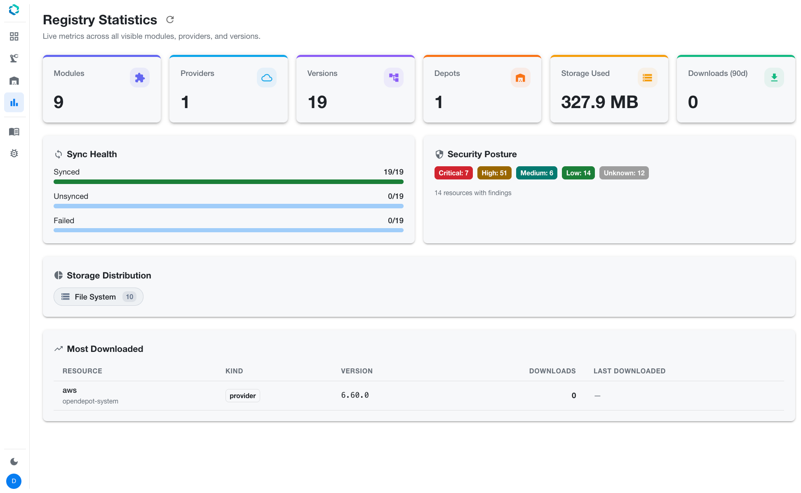

---
tags:
  - guides
  - ui
  - registry-explorer
---

# Stats

Stats provides an operational view of synchronization health, security posture,
storage, and resource usage across the OpenDepot Workshop resources visible to
you.

## Dashboard

The dashboard (`/stats`) shows:

| Section | Description |
|---------|-------------|
| Summary cards | Modules, providers, versions, depots, storage used, and downloads |
| Sync health | Synced, unsynced, and failed version counts |
| Security posture | Finding counts by severity, plus exempted findings |
| Storage distribution | Version counts by storage backend |
| Most downloaded | Resources with download totals and last-download timestamps |

Summary counts come from Kubernetes resources. Download counts come from
Prometheus over the lookback window set by `server.stats.lookback` (default
`90d`).

!!! note "Visibility"
    The dashboard uses the same visibility rules as OpenDepot Workshop. OIDC
    users with a matching `GroupBinding` see the resources allowed by that
    binding.

## Download Tracking

The Server exposes download metrics at `/metrics` on the metrics port (`9090`
by default). The chart creates a `ServiceMonitor` when `metrics.serviceMonitor.enabled`
is `true`, which is the default.

When `server.stats.prometheusURL` is empty, the chart points the Server at the
bundled Prometheus service. Set the URL to query an existing Prometheus instead.