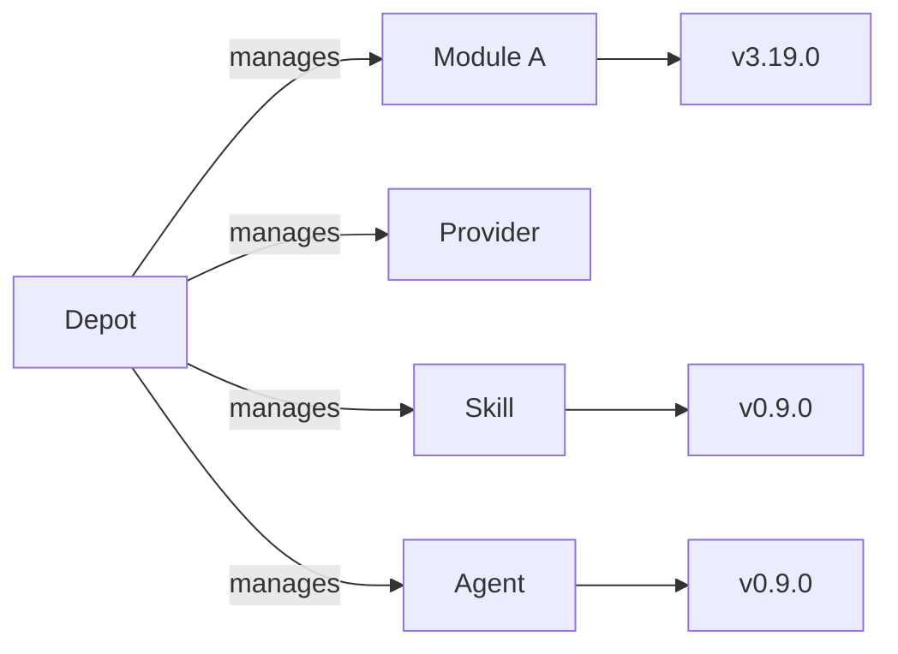

---
tags:
  - guides
  - ui
  - registry-explorer
  - depots
---

# Depots

The **Depots** page (`/depots`) renders an interactive graph of visible `Depot`
resources and the `Module`, `Provider`, `Skill`, and `Agent` resources each depot
manages. Every Module, Provider, Skill, and Agent with versions fans out to one
node per version.

Select a depot from the filter to narrow the graph. Each node opens a detail
panel with its namespace, name, storage backend and configuration, presigned URL
settings, and sync status. Skill and Agent versions without a version string are
labeled with their short commit SHA.

The graph is served by [`GET /opendepot/ui/v1/depots/graph`](../../reference/api.md#depot-relationship-graph)
and applies the same visibility rules as the rest of the Workshop.
