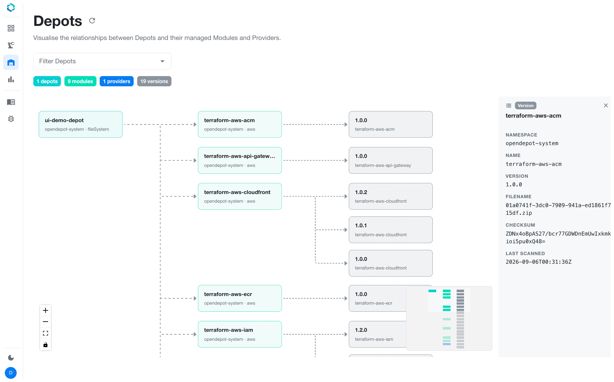
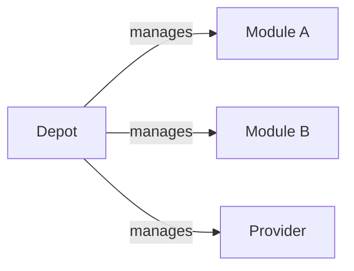

---
tags:
  - guides
  - ui
  - registry-explorer
  - depots
---

# Depots

The **Depots** page (`/depots`) graphs the visible `Depot` resources and the
`Module` and `Provider` resources each one manages.

Select a depot from the filter to narrow the graph. Each node opens a detail
panel with its namespace, name, storage backend and configuration, presigned URL
settings, and sync status.

The graph is served by [`GET /opendepot/ui/v1/depots/graph`](../../reference/api.md#depot-relationship-graph)
and applies the same visibility rules as the rest of the Workshop.
