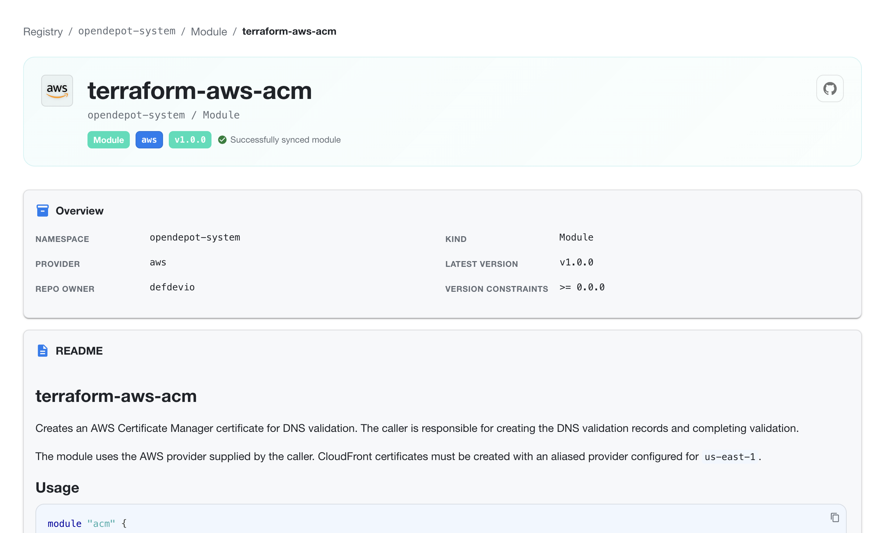
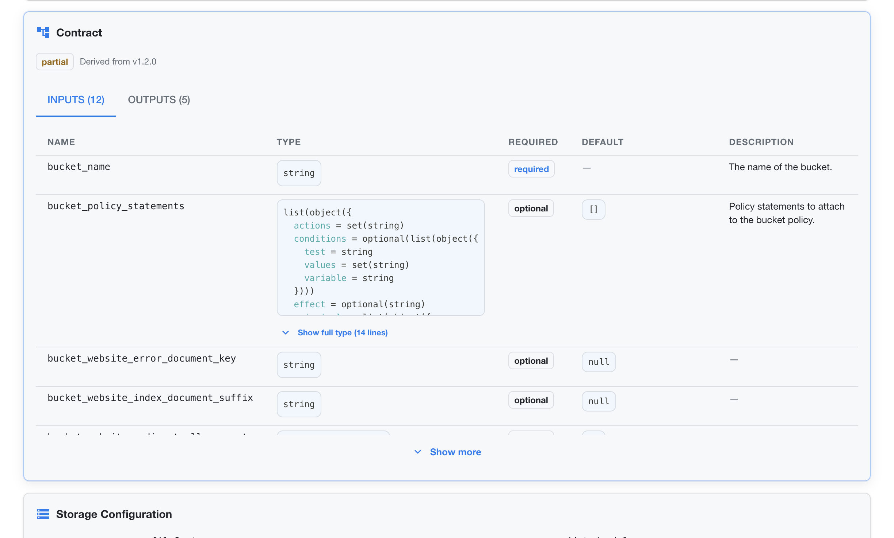
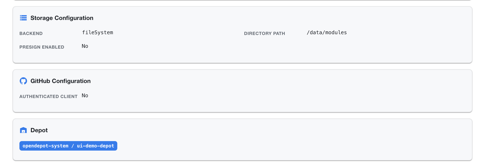
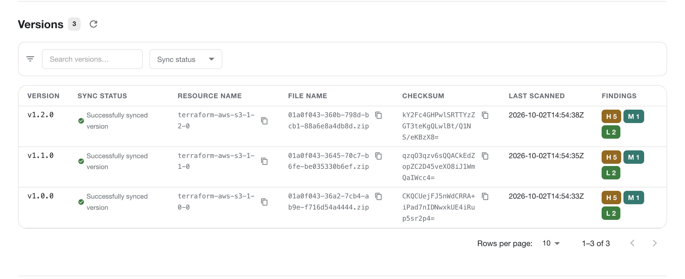
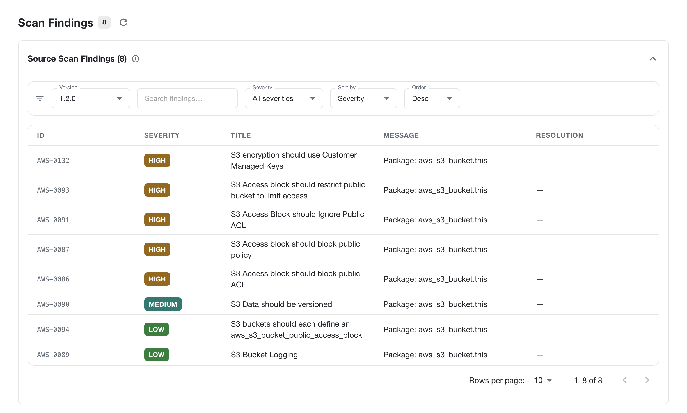

---
tags:
  - guides
  - ui
  - registry-explorer
  - module
---

# Module Details

The Module Details page shows one module: its current version, README, usage, contract, storage and GitHub configuration, versions, and scan findings.

## Module identity and status

The header shows the module name, its Kubernetes location, the latest synchronized version, and sync status. A link to the upstream source appears when one is configured.

The **Overview** section lists the namespace, kind, provider, repository owner, latest version, version history limit, and version constraints.

## README and usage

The **README** section renders the module README when one is available.

The **Usage** section provides a copyable module block with the OpenDepot source address and version constraint.

## Module contract

The **Contract** section shows the normalized interface extracted from the module source: inputs and outputs with their types, required status, defaults, and descriptions.

Use **Show more** to expand long input or output lists. A contract appears only when Assembly Line is enabled and the version has a derived contract.

!!! note
    Enable Assembly Line with `assembly.enabled: true` in the Helm values, and set `server.image.tag` and `version.image.tag` to a `-assembly` image tag. The UI must also be enabled with `ui.enabled: true`. See [Assembly Line Configuration](../../configuration/assembly-line.md).

## Storage, GitHub, and Depot settings

### Storage Configuration

The **Storage Configuration** section shows the backend, its location fields, and **Presign Enabled**. When **Presign Enabled** is `Yes`, downloads use pre-signed redirects instead of streaming through the server.

**GitHub Configuration** shows the authenticated client used for source metadata, if one is configured.

The **Depot** section names the `Depot` that manages the module.

## Versions

The **Versions** view lists synchronized module archives with their sync status, resource name, filename, checksum, scan timestamp, and findings.

Use the search field and **Sync status** filter to narrow the list. Each row shows the version, resource name, archive filename, checksum, last scan timestamp, and severity counts. Select a version to inspect its scan results.

## Scan Findings

The **Scan Findings** view lists findings for a selected module version. Use the **Version**, search, **Severity**, **Sort by**, and **Order** controls to filter the list.

Each finding shows its rule ID, severity, title, affected package or resource, message, and recommended resolution. Findings are deduplicated by rule ID, and only the highest-severity instance of each rule appears.

## Related views

- [Workshop](index.md)
- [Provider Details](provider-details.md)
- [Browse resources and dashboards](browse.md)
- [Browse API](api.md)
- [Workshop authentication](../../authentication/registry-explorer.md)
