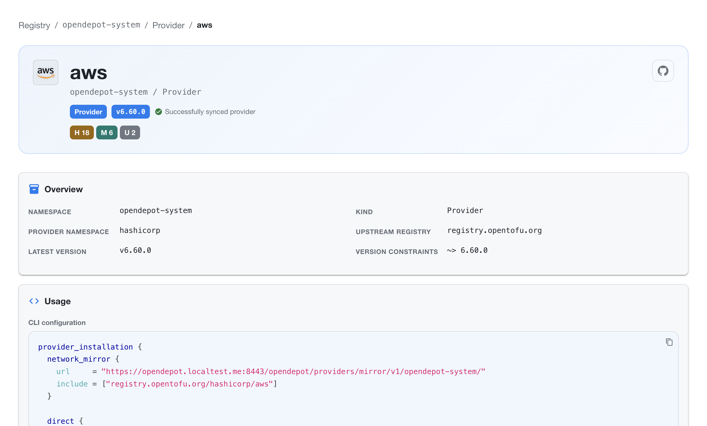
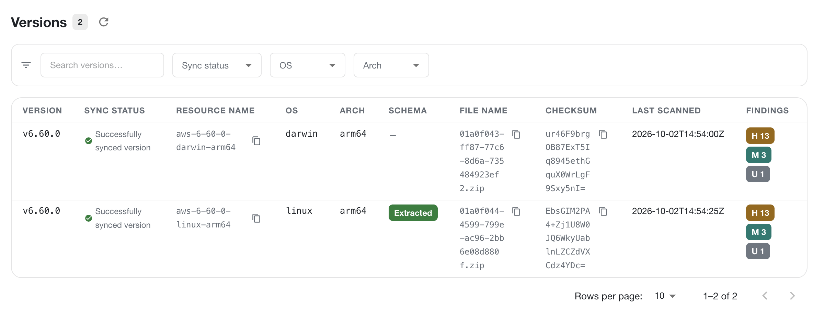
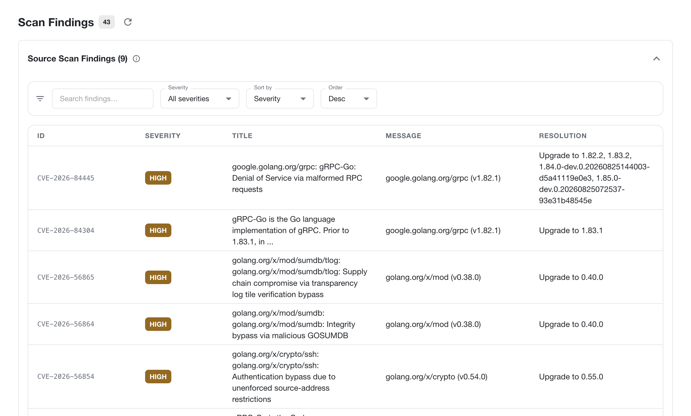

---
tags:
  - guides
  - ui
  - registry-explorer
  - provider
---

# Provider Details

The Provider Details page shows one provider: its registry identity, sync state, mirror usage configuration, platform versions, and scan findings.

## Provider identity and status

The header shows the provider name, its Kubernetes location, the latest version, sync status, and scan counts. A link to the upstream source appears when one is configured.

## Overview

The **Overview** section shows:

| Field | Description |
|-------|-------------|
| Namespace | Kubernetes namespace of the `Provider` resource |
| Kind | Resource kind |
| Provider Namespace | Registry namespace, such as `hashicorp`. Defaults to `hashicorp` |
| Upstream Registry | Registry used for discovery and downloads. Defaults to `registry.opentofu.org` |
| Latest Version | Most recent synchronized version |
| Version Constraints | Constraint used to select versions |

## Usage

The **Usage** section provides copyable network mirror configuration for `.tofurc` or `.terraformrc`. The mirror URL includes the deployment and namespace shown on the page.

## Versions and findings

The **Versions** view lists each synchronized provider artifact by platform. Use the search field and the **Sync status**, **OS**, and **Arch** filters to narrow the list.

Each row shows the version, sync status, resource name, OS, architecture, schema extraction status (`Extracted` or `Failed`), archive filename, checksum, last scan time, and finding counts. A version appears once per OS and architecture artifact. Select a row to inspect its scan results.

## Scan findings

The **Scan Findings** view lists the provider's source findings and binary findings in separate sections.

Use the **Version**, **OS**, **Arch**, search, **Severity**, **Sort by**, and **Order** controls to filter findings. Each finding shows its identifier, severity, title, affected package, message, and recommended resolution. Findings are deduplicated by rule ID.

Visibility follows the same rules as the rest of Workshop.

## Related views

- [Workshop](index.md)
- [Browse resources and dashboards](browse.md)
- [Browse API](api.md)
- [Workshop authentication](../../authentication/registry-explorer.md)
