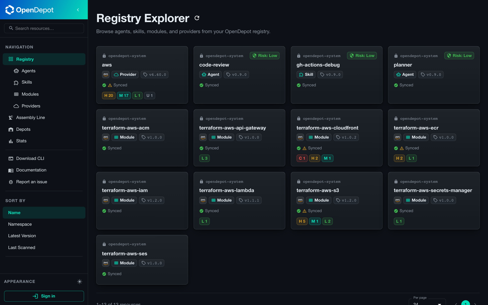

---
tags:
  - guides
  - ui
  - registry-explorer
  - browse
---

# Registry Explorer

The Registry Explorer is OpenDepot Workshop's discovery surface. It gives users
an overview of the modules, providers, skills, and agents available to them and
lets them open resource details, versions, and security information.

## Sidebar

The sidebar groups the Registry Explorer under a **Registry** item. The
children filter the explorer by kind:

| Item | Shows |
| --- | --- |
| Registry | All kinds: agents, skills, modules, and providers. |
| Agents | Only agents. |
| Skills | Only skills. |
| Modules | Only modules. |
| Providers | Only providers. |

Each item has an icon. When the sidebar is collapsed, only the icons appear.
Hover over an icon to see its name in a tooltip. The search icon in the
collapsed sidebar expands it and places the cursor in the search field.

## Reading the Registry Explorer

The explorer lists one resource per row and summarizes its latest available
version. Select a row to open the resource details.

| Column | Meaning |
| --- | --- |
| Kind | The resource kind: `Module`, `Provider`, `Skill`, or `Agent`. Modules and providers also show the icon of their provider ecosystem, such as AWS. |
| Name | The Kubernetes namespace that owns the resource, then the resource name. A globe icon marks a public resource. |
| Version | The latest version currently shown for the resource. |
| Source | For a Skill or Agent that follows a Git ref, the tracked branch or commit. The column is hidden when no resource on the page has one. |
| Status | Whether the latest version synchronized. A healthy resource shows **Synced**. A failure, or a version that Jev blocked, is shown in red with its reason in a tooltip. |
| Risk | For a Skill or Agent, the Jev risk level as a five-step meter from `Minimal` to `Critical`. For a Module or Provider, the number of scan findings by severity: `C` critical, `H` high, `M` medium, `L` low, `U` unknown, and `E` exempted. |

Above the list, the **Sort** menu orders resources by name, namespace, latest
version, or last scan, and the arrow next to it reverses the order. Selecting
the **Name** or **Version** column heading sorts by that column. Active
namespace and search filters appear next to the resource count and can be
removed there. The view toggle switches between the table and a card grid.
Narrow screens always use cards.

The footer shows the resource count, the **Per page** setting, and pagination
controls. The page size defaults to 12.

The browser saves your **Per page** choice, sort field and direction, and
table or card view in local storage, so they persist across visits. Preferences
are stored per browser, not per account.

## What users see

- **Modules**: versions, README, usage, contract, and scan findings.
- **Providers**: versions, platform artifacts, checksums, schema extraction status, and scan findings.

- **Modules** with versions, README content, usage examples, contracts, inputs,
  outputs, and scan findings.
- **Providers** with versions, platform artifacts, checksums, extracted schemas,
  and source or binary scan findings.
- **Skills** and **Agents** with versions, the `SKILL.md` or `AGENT.md`
  definition, tools and model metadata, scan findings, and Jev assessments when
  enabled. See [Consuming Agents and Skills](../agents.md).

The Registry Explorer shows the resources the current user can access. If a
resource is not visible, check the current authentication mode, public labels,
and any applicable `GroupBinding`.

## Related Guides

- [OpenDepot Workshop](index.md)
- [Module Details](module-details.md)
- [Provider Details](provider-details.md)
- [Consuming Agents and Skills](../agents.md)
- [OpenDepot Workshop Administration](administration.md)
- [OpenDepot Workshop authentication](../../authentication/registry-explorer.md)
